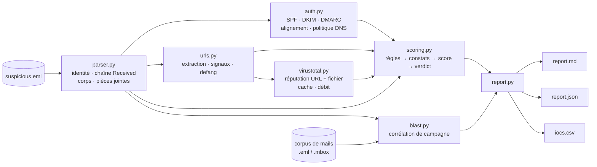

<div align="center">

# 🎣 PhishScope

**Boîte à outils d'investigation d'e-mails de phishing pour analystes SOC**
*Prouver l'usurpation · Vérifier SPF/DKIM/DMARC · Trier chaque lien · Mesurer le rayon d'impact · Livrer un verdict en une page*

[🇬🇧 English](README.md) · 🇫🇷 Français


[](https://github.com/NikoRNK/phishscope/actions)

</div>

---

## Sommaire

1. [Pourquoi ce projet](#pourquoi-ce-projet)
2. [L'investigation en 5 étapes](#linvestigation-en-5-étapes)
3. [Fonctionnalités](#fonctionnalités)
4. [Architecture](#architecture)
5. [Démarrage rapide](#démarrage-rapide)
6. [Utilisation](#utilisation)
7. [Exemple de sortie](#exemple-de-sortie)
8. [Logique de détection et score](#logique-de-détection-et-score)
9. [Correspondance MITRE ATT&CK](#correspondance-mitre-attck)
10. [Utilisation comme bibliothèque](#utilisation-comme-bibliothèque)
11. [Du labo au SOC en production](#du-labo-au-soc-en-production)
12. [Structure du projet](#structure-du-projet)
13. [Tests](#tests)
14. [Choix de conception et limites](#choix-de-conception-et-limites)
15. [Feuille de route](#feuille-de-route)
16. [Usage responsable](#usage-responsable)
17. [Auteur](#auteur) · [Licence](#licence)

---

## Pourquoi ce projet

Le phishing est le premier vecteur d'accès initial, et le tri des e-mails signalés
est l'une des tâches les plus répétitives d'un analyste SOC N1/N2. Le raisonnement
est toujours le même : *l'expéditeur est-il bien celui qu'il prétend être ? le
message s'est-il authentifié ? où mènent les liens ? qui d'autre l'a reçu ? que dire
à mon responsable ?*

**PhishScope automatise ce raisonnement de bout en bout, tout en gardant chaque
décision explicable.** Aucune boîte noire : chaque point du score de risque
remonte à un constat nommé, avec un poids, une preuve et une technique MITRE
ATT&CK. L'analyste peut donc défendre son verdict devant un manager ou un auditeur.

Le livrable est volontairement celui d'un vrai SOC :

* un **verdict** (`MALICIOUS` / `SUSPICIOUS` / `LIKELY BENIGN`) avec un **niveau de confiance**,
* un **rayon d'impact** (combien de personnes, quelle campagne),
* des **IOC « defangés »** prêts pour le ticket, le pare-feu et la TIP,
* des **actions de confinement recommandées**,
* un **code de sortie non nul** sur verdict malveillant, pour s'intégrer à un playbook SOAR.

## L'investigation en 5 étapes

| # | Étape de l'analyste | Ce que fait PhishScope | Module |
|---|---------------------|------------------------|--------|
| 1 | **Lire les en-têtes complets, prouver l'usurpation** | Tableau comparatif From / Return-Path / Reply-To / Message-ID, chaîne Received remise dans l'ordre origine→boîte avec délais par saut, IP d'origine, détection de domaines sosies et d'usurpation du nom d'affichage | `parser.py` |
| 2 | **Vérifier SPF, DKIM et DMARC** | Lit les verdicts de la passerelle, calcule l'*alignement* (ce que tout le monde oublie), récupère la politique DMARC/SPF publiée | `auth.py` |
| 3 | **Passer chaque lien dans VirusTotal** | Extrait les liens (`<a href>` + texte brut), signaux statiques, defanging, requête VT v3 pour URL et hash de pièces jointes avec cache et limitation de débit | `urls.py` `virustotal.py` |
| 4 | **Tracer qui d'autre l'a reçu** | Corrèle l'échantillon avec un corpus de mails sur 6 indicateurs ; ≥2 en commun = même campagne | `blast.py` |
| 5 | **Finir par un rapport d'une page : verdict et rayon d'impact** | Rapport Markdown (page 1 = verdict · rayon d'impact · actions), plus JSON et CSV d'IOC | `scoring.py` `report.py` |

> Détails de la méthodologie : [`docs/METHODOLOGY.md`](docs/METHODOLOGY.md) (en anglais)

## Fonctionnalités

- 🔍 **Forensique d'en-têtes** — tableau de preuve d'usurpation, chronologie Received, IP d'origine, détection d'anomalies temporelles
- 🔐 **Authentification bien faite** — SPF/DKIM/DMARC *et alignement* ; détecte le piège classique « SPF = pass (pour le domaine de l'attaquant) »
- 🎭 **Détection d'usurpation d'identité** — domaines sosies tenant compte des homoglyphes (`rn`→`m`, `0`→`o`, `1`→`l`), abus de marque dans le nom d'affichage, distance de Levenshtein
- 🔗 **Analyse des liens** — texte du lien ≠ href, hôte en IP brute, punycode, raccourcisseurs, astuce `user@host`, TLD abusés, HTTP en clair
- 📎 **Tri des pièces jointes** — hashes sans jamais rien exécuter, types à risque (`.html .iso .lnk .docm …`), double extension
- 🌐 **Threat intel** — VirusTotal v3 (bibliothèque standard uniquement), cache disque 24 h, respect du quota gratuit
- 🕸️ **Rayon d'impact** — corrélation de campagne sur exports `.eml` / `.mbox` → destinataires uniques et portée (`contained` / `limited` / `widespread`)
- 🧾 **Rapports** — Markdown (humain), JSON (machine), CSV (IOC), defangés par défaut
- 🧱 **Zéro dépendance obligatoire** — Python pur, bibliothèque standard (`dnspython` optionnel pour le DNS en direct)
- 🤖 **Compatible SOAR** — code de sortie `2` si `MALICIOUS`, `0` sinon

## Architecture



## Démarrage rapide

```bash
git clone https://github.com/NikoRNK/phishscope.git
cd phishscope
pip install -e .            # aucune dépendance à l'exécution
pip install -e ".[dns]"     # optionnel : requêtes DNS SPF/DMARC en direct

# Analyser la campagne d'exemple fournie (hors ligne)
phishscope analyze samples/phish_01.eml --no-dns --corpus samples/mailstore --out report.md
```

Nécessite **Python 3.9+**. Fonctionne sous Linux, macOS et Windows.

## Utilisation

```text
phishscope analyze <eml> [--corpus DIR] [--vt-key CLE] [--vt-max N] [--no-vt]
                         [--no-dns] [--cache DIR] [--out report.md]
                         [--json result.json] [--iocs iocs.csv]
phishscope headers <eml>
phishscope --version
```

| Option | Description |
|--------|-------------|
| `--corpus DIR` | Dossier (récursif) de fichiers `.eml` / `.mbox` pour le rayon d'impact |
| `--vt-key CLE` | Clé API VirusTotal. Par défaut : variable d'environnement `VT_API_KEY` |
| `--vt-max N` | Nombre max d'URL envoyées à VirusTotal, les plus suspectes d'abord (quota gratuit = 4 req/min). Défaut `6` |
| `--no-vt` | Ne jamais contacter VirusTotal (100 % hors ligne) |
| `--no-dns` | Ignorer les requêtes DNS SPF/DMARC en direct |
| `--out / --json / --iocs` | Écrit le rapport Markdown, le résultat JSON complet, le CSV d'IOC |

**Codes de sortie :** `0` = bénin / suspect · `2` = malveillant · `1` = erreur (ex. fichier introuvable).

### Scénarios typiques

```bash
# 1. Tri rapide des en-têtes
phishscope headers samples/phish_01.eml

# 2. Investigation complète hors ligne
phishscope analyze samples/phish_01.eml --no-dns --corpus ./mailstore --out case.md --iocs iocs.csv

# 3. Avec threat intel
export VT_API_KEY=xxxxxxxxxxxxxxxx
phishscope analyze suspicious.eml --corpus ./exports --out case.md --json case.json

# 4. Porte SOAR / CI
phishscope analyze suspicious.eml --no-vt --json out.json || echo "malveillant -> ouvrir un incident"
```

Récupérer le `.eml` : dans Outlook, *glisser le message sur le bureau* ou
**Enregistrer sous → .eml** ; dans Gmail **⋮ → Télécharger le message** ; dans
Thunderbird **Fichier → Enregistrer sous**. Toujours analyser le message
*original*, jamais un transfert.

## Exemple de sortie

Exécution sur la campagne d'exemple fournie :

```text
$ phishscope analyze samples/phish_01.eml --no-dns --corpus samples/mailstore --out report.md
[MALICIOUS] case=PI-A104FFF3 score=100/100 confidence=HIGH recipients=4
```

Page un du rapport généré (le rapport lui-même est en anglais) :

> ### 🔴 MALICIOUS — risque 100/100 — confiance HIGH
>
> Un message prétendant venir de **Microsoft Account Team \<no-reply@microsoft.com\>** a été relayé par
> **mail-relay-77.bulkmailer.example** (IP d'origine `203.0.113.45`). Authentification : SPF=pass, DKIM=none,
> DMARC=fail. 14 indicateurs déclenchés dans 5 catégories (pièce jointe, auth, contenu, identité, url) ;
> 3 liens sur 4 signalés.
>
> **Rayon d'impact** — portée : *limited* · 4 destinataires uniques · 2 messages liés trouvés (sur 3 analysés)

La **preuve d'usurpation**, ce dont se souvient un recruteur ou un manager :

| Champ | Valeur | Note |
|---|---|---|
| From (visible) | Microsoft Account Team \<no-reply@microsoft.com\> | Ce que voit la victime |
| Return-Path (enveloppe) | bounce@mail-relay-77.bulkmailer.example | Ce que SPF a réellement vérifié |
| Reply-To | helpdesk@rnicrosoft-support.example | Où part la réponse de la victime |
| IP d'origine | 203.0.113.45 | Premier saut public de la chaîne Received |

| Mécanisme | Résultat | Aligné avec From ? |
|---|---|---|
| SPF | pass | **NON** ← valide… pour le domaine de l'attaquant |
| DKIM | none | inconnu |
| DMARC | fail | — |

Principaux constats (liste complète dans [`examples/report_phish_01.md`](examples/report_phish_01.md)) :

| Poids | Constat | ATT&CK |
|---|---|---|
| 25 | DMARC = fail | T1656 |
| 25 | Le domaine Reply-To imite `microsoft` (`rnicrosoft-support[.]example`, *rn*→*m*) | T1583.001 |
| 20 | Le texte du lien affiche `login.microsoftonline.com`, le href mène ailleurs | T1566.002 |
| 15 | Expéditeur d'enveloppe ≠ From visible | T1656 |
| 15 | Lien vers IP brute `hxxp://203[.]0[.]113[.]45/verify` | T1566.002 |
| 15 | Pièce jointe à risque (`.html`) | T1566.001 |
| 12 | SPF passe — pour un domaine *différent* de From | T1656 |

Fichiers produits : [`report_phish_01.md`](examples/report_phish_01.md) ·
[`report_phish_01.json`](examples/report_phish_01.json) ·
[`iocs_phish_01.csv`](examples/iocs_phish_01.csv)

## Logique de détection et score

Chaque règle est explicite et pondérée. Le score est la somme des poids, plafonnée à 100.

| Catégorie | Règle | Poids |
|-----------|-------|:-----:|
| **Auth** | SPF fail / hardfail · softfail · none | 20 · 12 · 8 |
| | DKIM fail · none | 15 · 8 |
| | DMARC fail · none | 25 · 8 |
| | SPF pass **non aligné** · DKIM pass **non aligné** | 12 · 8 |
| **Identité** | Return-Path ≠ From (domaine organisationnel) | 15 |
| | Reply-To ≠ From | 15 |
| | Le nom d'affichage contient une autre adresse e-mail | 20 |
| | Le nom d'affichage usurpe une marque connue | 20 |
| | Domaine sosie (expéditeur / Reply-To) | 25 |
| | Domaine du Message-ID ≠ From | 5 |
| | Horodatages Received qui reculent dans le temps | 10 |
| **URL** | Domaine sosie | 25 |
| | Texte du lien ≠ href · astuce `user@host` | 20 · 20 |
| | Hôte en IP brute · punycode | 15 · 15 |
| | TLD à risque · raccourcisseur | 8 · 8 |
| | Sous-domaines profonds · HTTP en clair | 5 · 4 |
| **Pièce jointe** | Double extension (`facture.pdf.exe`) | 25 |
| | Type à risque (`.exe .scr .hta .lnk .js .iso .docm .html …`) | 10–25 |
| **Contenu** | Langage d'urgence / de pression (EN + FR) | 5–8 |
| **Intel** | URL VirusTotal ≥3 moteurs · 1–2 moteurs | 40 · 20 |
| | Pièce jointe VirusTotal ≥3 moteurs | 40 |

| Score | Verdict |
|-------|---------|
| ≥ 70, **ou** tout IOC confirmé par VirusTotal | 🔴 `MALICIOUS` |
| 35 – 69 | 🟠 `SUSPICIOUS` |
| < 35 | 🟢 `LIKELY BENIGN` |

**La confiance n'est pas le score** : elle mesure combien de **catégories de
preuves indépendantes** concordent (≥3 → `HIGH`, 2 → `MEDIUM`, 1 → `LOW`). Une
newsletter insistante peut avoir un score élevé sur le seul contenu et rester en
confiance `LOW` — c'est un humain qui tranche.

## Correspondance MITRE ATT&CK

| Technique | Où elle apparaît |
|-----------|------------------|
| [T1566.001](https://attack.mitre.org/techniques/T1566/001/) Spearphishing Attachment | Pièces jointes à risque, détections VirusTotal sur fichier |
| [T1566.002](https://attack.mitre.org/techniques/T1566/002/) Spearphishing Link | Tous les constats sur les URL |
| [T1656](https://attack.mitre.org/techniques/T1656/) Impersonation | Échecs d'authentification, champs d'identité usurpés |
| [T1583.001](https://attack.mitre.org/techniques/T1583/001/) Acquire Infrastructure: Domains | Domaines sosies |
| [T1036.007](https://attack.mitre.org/techniques/T1036/007/) Masquerading: Double File Extension | Pièces jointes à double extension |

## Utilisation comme bibliothèque

```python
from phishscope.engine import analyze
from phishscope.report import render_markdown
from phishscope.virustotal import VirusTotal

result = analyze(
    "suspicious.eml",
    corpus="./mailstore",
    vt=VirusTotal("VOTRE_CLE_API"),   # ou None pour rester hors ligne
    dns=True,
)

print(result["verdict"], result["risk_score"], result["confidence"])
for f in result["findings"]:
    print(f["weight"], f["id"], f["evidence"])

open("case.md", "w").write(render_markdown(result))
```

## Du labo au SOC en production

* [`docs/HUNTING_QUERIES.md`](docs/HUNTING_QUERIES.md) — la même logique de rayon d'impact en **KQL Microsoft Defender**,
  **Splunk SPL** et **Exchange Online** (recherche de conformité + purge), avec une checklist de confinement.
* Exporter `--json` pour pousser les cas dans un SIEM / outil de ticketing ; exporter `--iocs` pour alimenter une TIP ou une liste de blocage.
* Utiliser le code de sortie comme branche SOAR : `2` → ouverture automatique d'un incident.

## Structure du projet

```text
phishscope/
├── phishscope/
│   ├── parser.py        # identité, chaîne Received, corps, pièces jointes
│   ├── auth.py          # SPF / DKIM / DMARC, alignement, politique DNS
│   ├── urls.py          # extraction, signaux, defanging
│   ├── virustotal.py    # client VT v3 : cache + débit
│   ├── blast.py         # corrélation de campagne sur .eml / .mbox
│   ├── scoring.py       # règles, constats, score, verdict, actions
│   ├── engine.py        # orchestre les 5 étapes
│   ├── report.py        # Markdown / JSON / CSV
│   └── cli.py           # `phishscope analyze | headers`
├── samples/             # campagne de phishing synthétique + mail bénin (IP RFC 5737)
├── examples/            # rapport généré, JSON et CSV d'IOC
├── docs/                # méthodologie, requêtes de hunting
├── tests/               # 15 tests unitaires / d'intégration
└── .github/workflows/   # CI sur Python 3.9, 3.11, 3.12
```

## Tests

```bash
pip install -e ".[dev]"
pytest -q
```

15 tests couvrent l'analyse des en-têtes, la logique d'alignement, les signaux
d'URL, la détection de sosies, les verdicts sur un échantillon malveillant et un
bénin, et la précision du rayon d'impact (la campagne est trouvée, le mail bénin
ne l'est *pas*).

Tous les échantillons sont **synthétiques** : domaines réservés `.example` et
plages d'IP de documentation RFC 5737. La pièce jointe d'exemple est un simple
texte inerte.

## Choix de conception et limites

* **Heuristiques explicables plutôt que ML opaque.** L'analyste doit justifier un verdict ; chaque point est traçable.
* **L'alignement, pas seulement pass/fail.** La plupart des outils naïfs s'arrêtent à « SPF pass ». Le vrai signal : le domaine qui passe correspond-il à From ?
* **Conscience de la frontière de confiance.** Seuls l'`Authentication-Results` le plus haut et vos propres sauts Received sont fiables.
* **Consulter, jamais détoner.** Les appels VirusTotal interrogent seulement la réputation ; rien n'est téléchargé ni exécuté.
* **Limites :** un domaine d'attaquant propre et bien authentifié, sans lien, échappera aux règles statiques ;
  `org_domain()` utilise une petite liste de suffixes (installer `tldextract` pour l'exactitude) ;
  le scan de corpus remplace une vraie requête sur le stockage mail ; les clics doivent venir des logs proxy / EDR / Safe Links.

## Feuille de route

- [ ] Intégration sandbox (CAPE / Any.run) pour la détonation des pièces jointes
- [ ] Déroulage des chaînes de redirection avec récupération sécurisée
- [ ] Extraction de QR codes (quishing) depuis images et PDF
- [ ] Validation BIMI / chaîne ARC
- [ ] Export STIX 2.1 et envoi vers MISP
- [ ] Règles Sigma générées à partir des IOC extraits
- [ ] Rapport HTML avec chronologie

## Usage responsable

PhishScope est un outil **défensif** destiné à analyser des messages que vous
êtes autorisé à inspecter (phishing signalé dans votre organisation, échantillons
de labo). Il fait uniquement de l'analyse statique et des requêtes de réputation.
Ne l'utilisez pas pour profiler des tiers ni pour traiter du courrier que vous
n'avez pas le droit de lire.

## Auteur

**NikoRNK** — futur analyste SOC · [github.com/NikoRNK](https://github.com/NikoRNK)

Retours et pull requests bienvenus.

## Licence

[MIT](LICENSE) © 2026 NikoRNK
