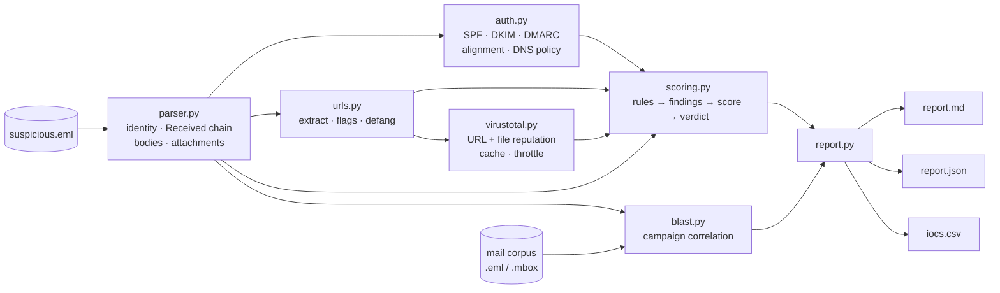

<div align="center">

# 🎣 PhishScope

**Phishing email investigation toolkit for SOC analysts**
*Prove the spoof · Verify SPF/DKIM/DMARC · Triage every link · Trace the blast radius · Ship a one-page verdict*

🇬🇧 English · [🇫🇷 Français](README.fr.md)


[](https://github.com/NikoRNK/phishscope/actions)

</div>

---

## Table of contents

1. [Why this project](#why-this-project)
2. [The 5-step investigation](#the-5-step-investigation)
3. [Features](#features)
4. [Architecture](#architecture)
5. [Quick start](#quick-start)
6. [Usage](#usage)
7. [Example output](#example-output)
8. [Detection logic & scoring](#detection-logic--scoring)
9. [MITRE ATT&CK mapping](#mitre-attck-mapping)
10. [Use it as a library](#use-it-as-a-library)
11. [From lab to production SOC](#from-lab-to-production-soc)
12. [Project layout](#project-layout)
13. [Tests](#tests)
14. [Design decisions & limitations](#design-decisions--limitations)
15. [Roadmap](#roadmap)
16. [Responsible use](#responsible-use)
17. [Author](#author) · [License](#license)

---

## Why this project

Phishing is the #1 initial-access vector, and triaging reported emails is one of
the most repetitive jobs of a SOC L1/L2 analyst. The reasoning is always the
same: *is the sender who they claim to be? did it authenticate? where do the
links go? who else got it? what do I tell my manager?*

**PhishScope automates that reasoning end-to-end while keeping every decision
explainable.** There is no black box: each point of the risk score traces back
to a named finding with a weight, evidence and a MITRE ATT&CK technique, so an
analyst can defend the verdict in front of a manager or an auditor.

It is deliberately built like a real SOC deliverable:

* a **verdict** (`MALICIOUS` / `SUSPICIOUS` / `LIKELY BENIGN`) with a **confidence** level,
* a **blast radius** (how many people, which campaign),
* **defanged IOCs** ready for the ticket, the firewall and the TIP,
* **recommended containment actions**,
* a **non-zero exit code** on malicious verdicts so it plugs into SOAR playbooks.

## The 5-step investigation

| # | Analyst step | What PhishScope does | Module |
|---|--------------|----------------------|--------|
| 1 | **Read the full headers, prove the spoof** | Side-by-side From / Return-Path / Reply-To / Message-ID, Received chain reordered origin→mailbox with hop delays, origin IP, lookalike & display-name impersonation | `parser.py` |
| 2 | **Check SPF, DKIM and DMARC** | Parses the gateway verdicts, computes *alignment* (the part people forget), fetches the published DMARC/SPF policy | `auth.py` |
| 3 | **Run every link through VirusTotal** | Extracts links (`<a href>` + raw text), static red flags, defanging, VT v3 lookup for URLs and attachment hashes with cache + throttling | `urls.py` `virustotal.py` |
| 4 | **Trace who else received it** | Correlates the sample with a mail corpus on 6 indicators; ≥2 shared = same campaign | `blast.py` |
| 5 | **End with a one-page report naming the verdict and the blast radius** | Markdown report (page 1 = verdict · blast radius · actions), plus JSON and IOC CSV | `scoring.py` `report.py` |

> Methodology details: [`docs/METHODOLOGY.md`](docs/METHODOLOGY.md)

## Features

- 🔍 **Header forensics** — spoof proof table, Received-chain timeline, origin IP, time-anomaly detection
- 🔐 **Authentication done right** — SPF/DKIM/DMARC *and alignment*; catches the classic "SPF = pass (for the attacker's domain)" trap
- 🎭 **Impersonation detection** — homoglyph-aware look-alike domains (`rn`→`m`, `0`→`o`, `1`→`l`), display-name brand abuse, Levenshtein matching
- 🔗 **Link analysis** — anchor/href mismatch, raw-IP hosts, punycode, shorteners, `user@host` tricks, abused TLDs, plain HTTP
- 📎 **Attachment triage** — hashes without executing anything, risky types (`.html .iso .lnk .docm …`), double-extension masquerade
- 🌐 **Threat intel** — VirusTotal v3 (stdlib only), 24 h on-disk cache, free-tier rate limiting
- 🕸️ **Blast radius** — campaign correlation across `.eml` / `.mbox` exports → unique recipients and scope (`contained` / `limited` / `widespread`)
- 🧾 **Reports** — Markdown (human), JSON (machine), CSV (IOCs), defanged by default
- 🧱 **Zero hard dependencies** — pure Python standard library (optional `dnspython` for live DNS)
- 🤖 **SOAR-friendly** — exit code `2` on `MALICIOUS`, `0` otherwise

## Architecture



## Quick start

```bash
git clone https://github.com/NikoRNK/phishscope.git
cd phishscope
pip install -e .            # no runtime dependencies
pip install -e ".[dns]"     # optional: live SPF/DMARC DNS lookups

# Analyse the bundled sample campaign (offline)
phishscope analyze samples/phish_01.eml --no-dns --corpus samples/mailstore --out report.md
```

Requires **Python 3.9+**. Works on Linux, macOS and Windows.

## Usage

```text
phishscope analyze <eml> [--corpus DIR] [--vt-key KEY] [--vt-max N] [--no-vt]
                         [--no-dns] [--cache DIR] [--out report.md]
                         [--json result.json] [--iocs iocs.csv]
phishscope headers <eml>
phishscope --version
```

| Option | Description |
|--------|-------------|
| `--corpus DIR` | Folder (recursive) of `.eml` / `.mbox` files used for the blast radius |
| `--vt-key KEY` | VirusTotal API key. Defaults to the `VT_API_KEY` environment variable |
| `--vt-max N` | Maximum URLs sent to VirusTotal, most suspicious first (free tier = 4 req/min). Default `6` |
| `--no-vt` | Never contact VirusTotal (fully offline) |
| `--no-dns` | Skip live SPF/DMARC DNS lookups |
| `--out / --json / --iocs` | Write the Markdown report, full JSON result, IOC CSV |

**Exit codes:** `0` = benign / suspicious · `2` = malicious · `1` = error (e.g. file not found).

### Typical workflows

```bash
# 1. Quick header triage
phishscope headers samples/phish_01.eml

# 2. Full offline investigation
phishscope analyze samples/phish_01.eml --no-dns --corpus ./mailstore --out case.md --iocs iocs.csv

# 3. With threat intel
export VT_API_KEY=xxxxxxxxxxxxxxxx
phishscope analyze suspicious.eml --corpus ./exports --out case.md --json case.json

# 4. SOAR / CI gate
phishscope analyze suspicious.eml --no-vt --json out.json || echo "malicious -> open incident"
```

How to get the `.eml`: in Outlook *drag the message to the desktop* or use
**Save as → .eml**; in Gmail **⋮ → Download message**; in Thunderbird
**File → Save as**. Always analyse the *original* message, never a forward.

## Example output

Running on the bundled sample campaign:

```text
$ phishscope analyze samples/phish_01.eml --no-dns --corpus samples/mailstore --out report.md
[MALICIOUS] case=PI-A104FFF3 score=100/100 confidence=HIGH recipients=4
```

Page one of the generated report:

> ### 🔴 MALICIOUS — risk 100/100 — confidence HIGH
>
> A message claiming to come from **Microsoft Account Team \<no-reply@microsoft.com\>** was relayed by
> **mail-relay-77.bulkmailer.example** (origin IP `203.0.113.45`). Authentication: SPF=pass, DKIM=none,
> DMARC=fail. 14 indicators fired across 5 categories (attachment, auth, content, identity, url);
> 3 of 4 links flagged.
>
> **Blast radius** — scope: *limited* · 4 unique recipients · 2 related messages found (of 3 scanned)

The **proof of spoof**, the part a recruiter or a manager remembers:

| Field | Value | Note |
|---|---|---|
| From (visible) | Microsoft Account Team \<no-reply@microsoft.com\> | What the victim sees |
| Return-Path (envelope) | bounce@mail-relay-77.bulkmailer.example | Who SPF really checked |
| Reply-To | helpdesk@rnicrosoft-support.example | Where the victim's answer goes |
| Origin IP | 203.0.113.45 | First public hop in the Received chain |

| Mechanism | Result | Aligned with From? |
|---|---|---|
| SPF | pass | **NO** ← passes… for the attacker's domain |
| DKIM | none | unknown |
| DMARC | fail | — |

Top findings (full list in [`examples/report_phish_01.md`](examples/report_phish_01.md)):

| Weight | Finding | ATT&CK |
|---|---|---|
| 25 | DMARC = fail | T1656 |
| 25 | Reply-To domain imitates `microsoft` (`rnicrosoft-support[.]example`, *rn*→*m*) | T1583.001 |
| 20 | Link text shows `login.microsoftonline.com`, href goes elsewhere | T1566.002 |
| 15 | Envelope sender ≠ visible From | T1656 |
| 15 | Link to raw IP `hxxp://203[.]0[.]113[.]45/verify` | T1566.002 |
| 15 | High-risk attachment type (`.html`) | T1566.001 |
| 12 | SPF passes — for a *different* domain than From | T1656 |

Files produced: [`report_phish_01.md`](examples/report_phish_01.md) ·
[`report_phish_01.json`](examples/report_phish_01.json) ·
[`iocs_phish_01.csv`](examples/iocs_phish_01.csv)

## Detection logic & scoring

Every rule is explicit and weighted. The score is the sum of weights, capped at 100.

| Category | Rule | Weight |
|----------|------|:------:|
| **Auth** | SPF fail / hardfail · softfail · none | 20 · 12 · 8 |
| | DKIM fail · none | 15 · 8 |
| | DMARC fail · none | 25 · 8 |
| | SPF pass **not aligned** · DKIM pass **not aligned** | 12 · 8 |
| **Identity** | Return-Path ≠ From (org domain) | 15 |
| | Reply-To ≠ From | 15 |
| | Display name contains a different e-mail address | 20 |
| | Display name impersonates a known brand | 20 |
| | Look-alike sender / Reply-To domain | 25 |
| | Message-ID domain ≠ From | 5 |
| | Received timestamps go backwards | 10 |
| **URL** | Look-alike domain | 25 |
| | Anchor text ≠ href · `user@host` trick | 20 · 20 |
| | Raw IP host · punycode | 15 · 15 |
| | Risky TLD · shortener | 8 · 8 |
| | Deep subdomain · plain HTTP | 5 · 4 |
| **Attachment** | Double extension (`invoice.pdf.exe`) | 25 |
| | Risky type (`.exe .scr .hta .lnk .js .iso .docm .html …`) | 10–25 |
| **Content** | Urgency / pressure language (EN + FR) | 5–8 |
| **Intel** | VirusTotal URL ≥3 engines · 1–2 engines | 40 · 20 |
| | VirusTotal attachment ≥3 engines | 40 |

| Score | Verdict |
|-------|---------|
| ≥ 70, **or** any VirusTotal-confirmed IOC | 🔴 `MALICIOUS` |
| 35 – 69 | 🟠 `SUSPICIOUS` |
| < 35 | 🟢 `LIKELY BENIGN` |

**Confidence** is *not* the score: it measures how many **independent evidence
categories** agree (≥3 → `HIGH`, 2 → `MEDIUM`, 1 → `LOW`). A pushy newsletter
can score high on content alone and still get `LOW` confidence — a human decides.

## MITRE ATT&CK mapping

| Technique | Where it appears |
|-----------|------------------|
| [T1566.001](https://attack.mitre.org/techniques/T1566/001/) Spearphishing Attachment | Risky attachments, VirusTotal file hits |
| [T1566.002](https://attack.mitre.org/techniques/T1566/002/) Spearphishing Link | All URL findings |
| [T1656](https://attack.mitre.org/techniques/T1656/) Impersonation | Auth failures, spoofed identity fields |
| [T1583.001](https://attack.mitre.org/techniques/T1583/001/) Acquire Infrastructure: Domains | Look-alike domains |
| [T1036.007](https://attack.mitre.org/techniques/T1036/007/) Masquerading: Double File Extension | Double-extension attachments |

## Use it as a library

```python
from phishscope.engine import analyze
from phishscope.report import render_markdown
from phishscope.virustotal import VirusTotal

result = analyze(
    "suspicious.eml",
    corpus="./mailstore",
    vt=VirusTotal("YOUR_API_KEY"),   # or None to stay offline
    dns=True,
)

print(result["verdict"], result["risk_score"], result["confidence"])
for f in result["findings"]:
    print(f["weight"], f["id"], f["evidence"])

open("case.md", "w").write(render_markdown(result))
```

## From lab to production SOC

* [`docs/HUNTING_QUERIES.md`](docs/HUNTING_QUERIES.md) — the same blast-radius logic as **Microsoft Defender KQL**,
  **Splunk SPL** and an **Exchange Online** compliance search + purge, plus a containment checklist.
* Export `--json` to push cases into a SIEM / ticketing system; export `--iocs` to feed a TIP or blocklist.
* Use the exit code as a SOAR branch: `2` → auto-open an incident.

## Project layout

```text
phishscope/
├── phishscope/
│   ├── parser.py        # identity, Received chain, bodies, attachments
│   ├── auth.py          # SPF / DKIM / DMARC, alignment, DNS policy
│   ├── urls.py          # extraction, red flags, defanging
│   ├── virustotal.py    # VT v3 client: cache + throttle
│   ├── blast.py         # campaign correlation over .eml / .mbox
│   ├── scoring.py       # rules, findings, score, verdict, actions
│   ├── engine.py        # orchestrates the 5 steps
│   ├── report.py        # Markdown / JSON / CSV
│   └── cli.py           # `phishscope analyze | headers`
├── samples/             # synthetic phishing campaign + benign mail (RFC 5737 IPs)
├── examples/            # generated report, JSON and IOC CSV
├── docs/                # methodology, hunting queries
├── tests/               # 15 unit / integration tests
└── .github/workflows/   # CI on Python 3.9, 3.11, 3.12
```

## Tests

```bash
pip install -e ".[dev]"
pytest -q
```

15 tests cover header parsing, alignment logic, URL flags, look-alike detection,
verdicts on a malicious and a benign sample, and blast-radius precision
(the campaign is found, the benign mail is *not*).

All samples are **synthetic**: reserved `.example` domains and RFC 5737
documentation IP ranges. The sample attachment is an inert text placeholder.

## Design decisions & limitations

* **Explainable heuristics over opaque ML.** Analysts must justify a verdict; every point is traceable.
* **Alignment, not just pass/fail.** Most naive tools stop at "SPF pass". The real signal is whether the passing domain matches From.
* **Trust boundary awareness.** Only the topmost `Authentication-Results` and your own Received hops are trusted.
* **Lookup, never detonate.** VirusTotal calls only query reputation; nothing is fetched or executed.
* **Limitations:** a clean, well-authenticated attacker domain with no links will evade static rules;
  `org_domain()` uses a small suffix list (install `tldextract` for exactness);
  the corpus scan stands in for a real mail-store query; click telemetry must come from proxy / EDR / Safe Links logs.

## Roadmap

- [ ] Sandbox integration (CAPE / Any.run) for attachment detonation
- [ ] URL redirect-chain unrolling with safe fetching
- [ ] QR-code (quishing) extraction from images and PDFs
- [ ] BIMI / ARC chain validation
- [ ] STIX 2.1 export and MISP push
- [ ] Sigma rules generated from the extracted IOCs
- [ ] HTML report with timeline

## Responsible use

PhishScope is a **defensive** tool for analysing messages you are authorised to
inspect (your own organisation's reported phishing, lab samples). It performs
static analysis and reputation lookups only. Do not use it to profile third
parties or to process mail you have no right to read.

## Author

**NikoRNK** — aspiring SOC analyst · [github.com/NikoRNK](https://github.com/NikoRNK)

Feedback and pull requests are welcome.

## License

[MIT](LICENSE) © 2026 NikoRNK
